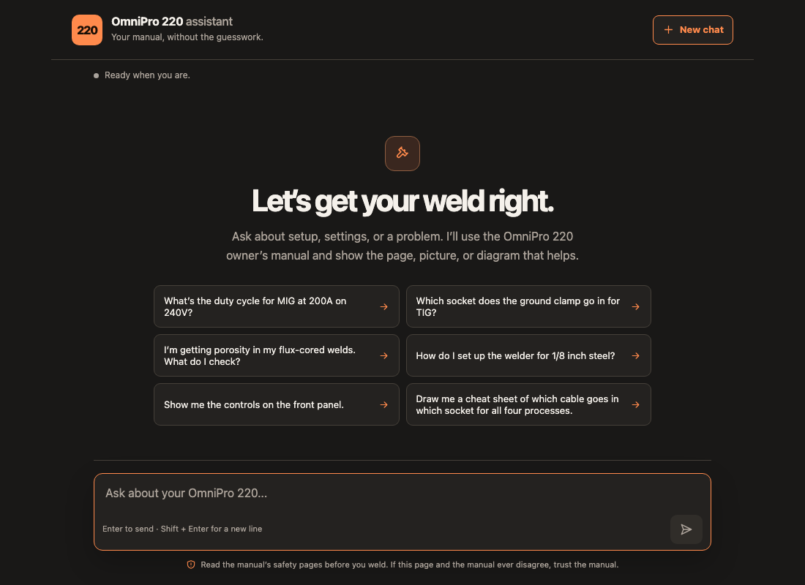
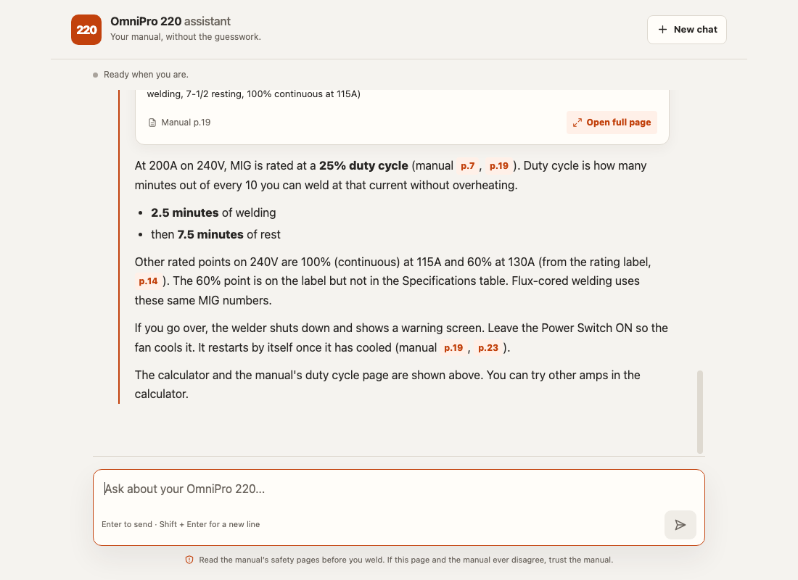
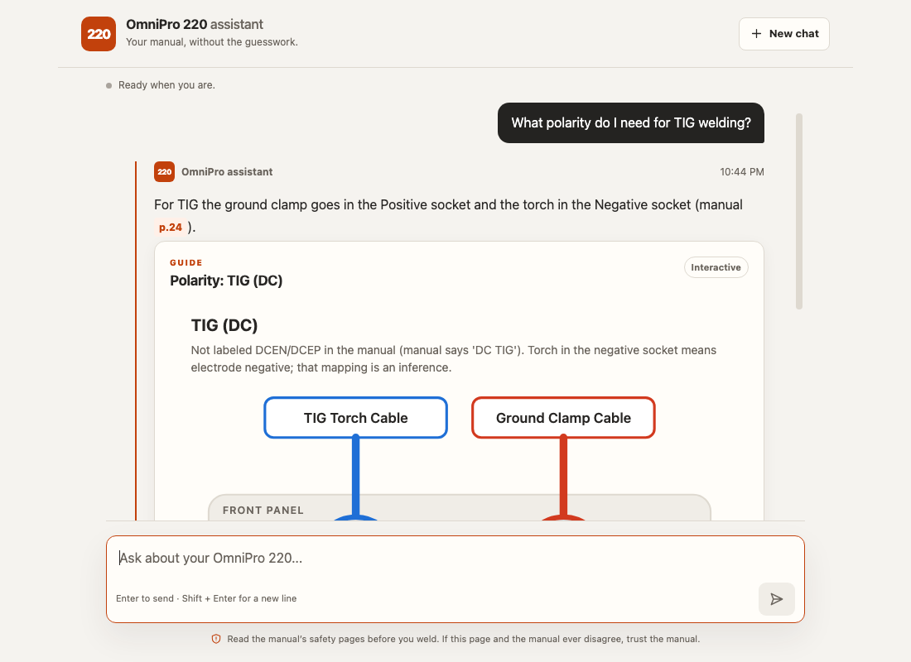
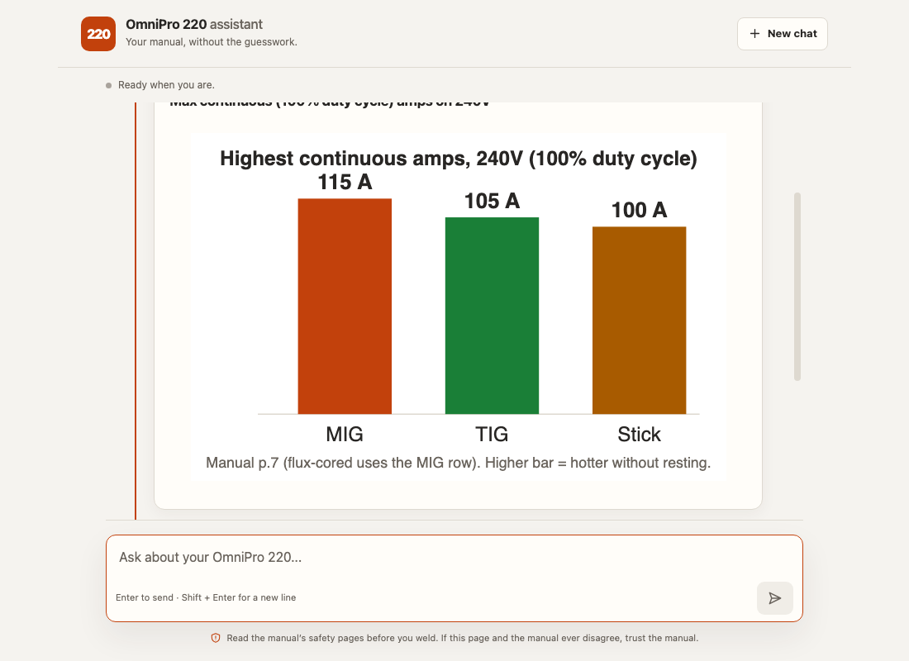
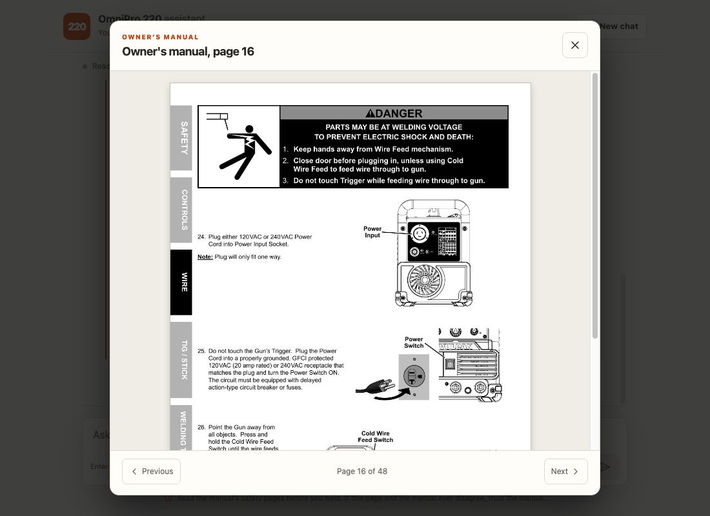
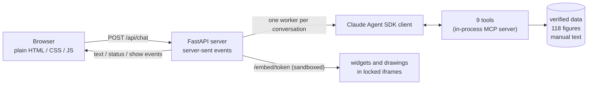

# OmniPro 220 assistant

A multimodal support agent for the **Vulcan OmniPro 220** multiprocess welder, built on the **Claude Agent SDK**.
Ask it anything about the machine. It answers from the 48-page owner's manual, **shows the manual's own pictures**,
**draws** the diagrams that are easier to see than to read, and opens **interactive tools** (duty-cycle calculator,
troubleshooting flowchart, setup sheet) inside the chat.

> **Video walkthrough:** <VIDEO_LINK>

<p align="center">
  
  
</p>
<p align="center">
  
  
</p>
<p align="center">
  
</p>

*Top: the welcome screen, and a real answer. Middle: a polarity diagram, and a drawing Claude wrote itself. Bottom: clicking a page citation opens that manual page. The real-answer screenshot predates one change: the page now puts the answer text first and the pictures after it.*

**Contents:** [Run it](#run-it-about-2-minutes) · [Try these](#try-these-first) · [What the assessment asks for](#what-the-assessment-asks-for-and-where-it-is) · [How the agent works](#how-the-agent-works) · [Knowledge extraction](#knowledge-extraction-and-representation) · [The multimodal part](#the-multimodal-part) · [Design decisions](#design-decisions-and-trade-offs) · [Testing](#how-i-tested-it) · [Limits](#limits-stated-plainly) · [Repo map](#repository-map)

---

## Run it (about 2 minutes)

```bash
git clone https://github.com/SomeshBhandarkar/prox-challenge
cd prox-challenge
cp .env.example .env          # then paste your ANTHROPIC_API_KEY into .env
python3 run.py                # first run creates a private .venv and installs (about 10 s); opens http://localhost:8000
```

Python 3.10 or newer (`python run.py` on Windows). That one key in `.env` is the only thing you supply. Nothing is installed outside the project folder, and there is no `npm` step: the page is plain HTML, CSS and JavaScript.

| Want to... | Do this |
|---|---|
| Choose the model | The default is **Sonnet 5.5**. `python3 run.py --model haiku` is the cheapest; `--model opus` is available. Or set `MODEL=` in `.env`. |
| Not open a browser tab | `python3 run.py --no-open` |
| Cap spending per conversation | `SESSION_BUDGET_USD=0.50` in `.env` (default `1.00`) |
| Use another port | `APP_PORT=8123` in `.env` (if 8000 is busy, the next free port is used automatically) |
| Try the page with **no key and no cost** | `python3 run.py --setup-only`, then `.venv/bin/python -m scripts.dev_server`, open http://localhost:8100 and type `everything`, `callout`, `broken`, `slow`... (canned replies that only exercise the page) |
| Run the tests (no API calls) | `.venv/bin/pip install -r requirements-dev.txt && .venv/bin/python -m pytest tests -q` |
| Chat in the terminal instead | `python3 run.py --terminal "How do I set up TIG?" --model haiku` |

**If something goes wrong**, the app says what to do: a missing, empty or placeholder key, a typo in the model name, a bad port or budget setting, or Python older than 3.10 each give a one-line fix. A wrong key shows *"The API key was refused. Check ANTHROPIC_API_KEY in .env, then restart."* in the page. A harmless line saying *"claude.ai connectors are disabled because ANTHROPIC_API_KEY is set"* appears in the terminal; it is the SDK noting that your key takes priority over a Claude login.

The first install downloads about 100 MB (about 290 MB on disk), mostly because the Claude Agent SDK bundles its own engine. On a fast connection that is a few seconds; on slow Wi-Fi it can take a minute or two.

**Cost.** The whole manual is part of every request, but the SDK caches it. The first question writes the cache (about 22 cents on Sonnet 5.5); questions asked soon after read it and cost about 4-8 cents. If the conversation sits idle long enough for the cache to expire, the next question pays the write again. Measured on Haiku 5.5: about 0.3 cent per question (the full 85-question exam cost $0.25). I did not measure Opus (see *Limits*).

### Try these first

| Type this | What it is meant to do |
|---|---|
| *What's the duty cycle for MIG at 200A on 240V?* | 25%: 2.5 minutes welding, 7.5 resting, cited to p.7 and p.19, with the calculator and the manual's duty-cycle page |
| *Which socket does the ground clamp go in for TIG?* | A drawn socket diagram: clamp to Positive, torch to Negative |
| *I'm getting porosity in my flux-cored welds. What do I check?* | The causes that apply to gasless wire (the gas causes are skipped), a flowchart to walk through, the manual's porosity picture |
| *How do I set up the welder for 1/8 inch steel?* | A setup sheet with a tab per process; it asks first if it needs something, such as your input voltage |
| *Can I use it in light rain if I keep it under a tarp?* | Meant to be a plain "no" from the safety page (p.4: do not use outdoors, do not expose to rain), with no workaround offered |
| *Draw me a cheat sheet of which cable goes in which socket for all four processes.* | The manual's own cable cheat sheet, or a drawing of one |

---

## What the assessment asks for, and where it is

| They test | What I built | Evidence |
|---|---|---|
| **Deep technical accuracy** (duty cycle, porosity, polarity; cross-references; ambiguity) | Numbers come only from tools backed by verified data, each with a manual page cite. Ambiguous questions get one clarifying question. Where the manual contradicts itself, the agent says so. | An 85-question exam with traps, hold-outs and multi-turn questions; every answer in the full run was read against the manual (below). |
| **Multimodal responses** (the most important part) | Exact picture crops, a drawn polarity diagram, an interactive duty-cycle calculator, a troubleshooting flowchart, a setup sheet, and free-form drawings the model writes itself, run in a locked-down sandbox. | Screenshots above; a real Sonnet answer drew a correct bar chart from the manual's numbers. |
| **Tone** (new owner in the garage) | Plain words, short sentences, jargon explained once, safety labels (DANGER / WARNING / CAUTION / NOTICE) styled like the manual. | Read across the whole exam run. |
| **Knowledge extraction** (tables, diagrams, schematics, image-only pages) | Text kept page-tagged; tables turned into verified data; every page that has a picture has an exact crop (118 figures); the image-only selection chart is transcribed by eye. | `knowledge/`, and the tests that guard it. |
| **Frontend, README, video** | A plain-HTML chat page, this document, and a walkthrough video. | Screenshots above; the video link at the top. |
| **Runs within 2 minutes** | `python3 run.py` does the install. | Timed from a fresh clone: 6 s with a warm cache. |

---

## How the agent works



**One agent, nine tools.** Not a swarm of agents: the assignment asks for *a* reasoning agent, and one agent with good tools is easier to reason about and to test.

### One question, step by step

You type *"What's the duty cycle for MIG at 200A on 240V?"*

1. **The page** posts it to `/api/chat`. The server passes it to this conversation's worker, which owns the SDK client, and a status line tells you something is happening.
2. **Claude reads it** with the whole manual, the figure catalog and the rules already in its (cached) system prompt. It does not answer the number from memory: it calls `duty_cycle(process="mig", voltage=240, amps=200)`.
3. **The lookup** answers from verified data: a *rated point*, 25%, 2.5 minutes on and 7.5 off, source p.7. (For 150A it would say "not a rated point", plan with the next rating up, and label any estimate as *not from the manual*.)
4. **Claude asks for pictures:** `show_duty_cycle_calculator(...)` and `show_figure("duty-cycle-section-mig")`. The server sees those tool calls in the SDK's message stream, runs the same builders with the same inputs, and stores the calculator's HTML under a random token. Claude only gets back one sentence ("The calculator is now shown to the user").
5. **Claude writes the answer once**, quoting the lookup and citing pages.
6. **The page** renders the text first (`p.7` becomes a button that opens that manual page), then the calculator in a sandboxed frame and the manual's own p.19 picture, and scrolls to the start of the answer.

### The tools

| Tool | Kind | What it does |
|---|---|---|
| `duty_cycle` | lookup | Exact duty cycle from verified data; never from memory. Handles in-between amps, out-of-range amps and 120V vs 240V. |
| `polarity` | lookup | Which cable goes in which socket, per process. |
| `view_manual_page` | eyes | Lets Claude *look* at a full manual page image (for tables or drawings it has no data for). |
| `show_figure` | show | Displays an exact cropped picture from the manual, chosen by id from a catalog of 118. |
| `show_polarity_diagram` | show | Draws the socket diagram (SVG) from the verified polarity data. |
| `show_duty_cycle_calculator` | show | Interactive calculator, precomputed from the same lookup, so the widget and the agent can never disagree. |
| `show_troubleshooting_flowchart` | show | Step-by-step flowchart from the manual's troubleshooting tables (also returns the exact steps to Claude). |
| `show_setup_guide` | show | A setup sheet for a job: chart fit, polarity, gas, feed roller and tension, LCD steps with *your* entries, limits. |
| `create_artifact` | draw | Claude writes small HTML or SVG and the page runs it in a sandbox. |

### The "show contract"
Show tools are *pure functions of their inputs*. The server watches the SDK's message stream for a show-tool call, runs the same builder with the same input, and sends the result to the page. The tool result that goes back to Claude is only a short sentence, so **HTML never costs model tokens**, and what is on screen can never differ from what the model "saw" (`app/show.py`).

### The whole manual is in the prompt
No vector database, no retrieval. The system prompt (about 43k tokens, which the SDK caches) is built by `app/prompt.py` from:

1. **Role and tone:** a new owner in the garage, neither an idiot nor a pro; short, plain, safety first.
2. **Accuracy rules:** numbers only from tools or the manual, always cite the page, say "the manual doesn't say" instead of guessing, ask one question when something decisive is missing.
3. **Show rules:** which picture or tool answers which kind of question, call show tools first and write the answer once, when to draw something yourself.
4. **Generated fact blocks**, built from the tested data so they cannot drift: the selection chart, the manual's known contradictions, a "the manual does NOT say" list, and a few checked wiring-schematic facts.
5. **The figure catalog** (118 ids with page and caption) and the **troubleshooting problem list**.
6. **The manual itself,** page-tagged.

For a document this size that is simpler and more accurate than chunk retrieval: the model can cross-reference pages freely (a duty-cycle answer uses p.7, p.19 and the rating label on p.14), and a retrieval miss cannot cost an answer.

### The page and the server
- **Streaming.** `POST /api/chat` streams events: `session`, `status` ("Reading a page of the manual..."), `text`, `show`, `error`, `done`. Each conversation is one background task that owns its SDK client (the SDK must open and close a client from the same task, and every web request runs in a different one), so requests only pass questions through a queue. One question at a time per conversation, idle conversations expire after 30 minutes, at most 10 at once.
- **Safe rendering.** Text is escaped first, then a small markdown renderer adds bold, lists and tables; there are no links, images or raw HTML. `p.14` becomes a button that opens that manual page in a viewer. Paragraphs that start with DANGER, WARNING, CAUTION or NOTICE become callouts styled like the manual's own labels.
- **Pictures and tools.** Figures appear as cards (caption, source, "Open full page", click to enlarge). Widgets and drawings run in sandboxed frames that report their height back to the page.
- **Comfort.** Follows the system's light or dark setting, fits a 390 px phone, respects reduced motion, and has a short startup screen you can skip with a tap or any key.

---

## Knowledge extraction and representation

The manual mixes text, tables, labelled diagrams, schematics and image-only pages. Each kind is handled differently, and the work is done once and committed, so nothing heavy runs at startup.

**How the extraction was done:**

1. **Text.** poppler's `pdftotext` per page, saved as `knowledge/manual.txt` with `=====PAGE n=====` markers. The text layer scrambles some table columns, so **no number is trusted from it alone.**
2. **Tables to data.** The specifications, the rating-label points, polarity, the 13 troubleshooting problems (53 cause-and-fix steps), the LCD steps and the selection chart were retyped as JSON in `knowledge/data/`, each entry carrying its page. Tests then check every word of each entry against the cited page.
3. **Pictures to crops.** Each figure is cut from the PDF with `pdftoppm` using a box recorded as fractions of the page. Edges were placed in the white gaps found by scanning the page's pixels (a throwaway authoring helper, not in the repo), so a crop never slices through a drawing, and every crop was looked at. Tiny detail is cut at higher resolution (the rating label at 1200 DPI, the schematic and parts diagram at 300 DPI).
4. **Image-only pages.** The selection chart has no text layer at all. It was read by eye at 200 DPI, transcribed into data, and given a check card (`knowledge/factcheck/SELECTION_CHART_CHECK.md`) so a person can compare it with the original.
5. **Catalog.** Every crop has an id, page, box, caption and an "answers" list (which questions it helps with). Text that exists only *inside* a picture, such as an LCD screen, is recorded as `picture_text` so tests can still check captions.

**How each kind is represented, and kept honest:**

| In the manual | Represented as | How it is kept honest |
|---|---|---|
| Running text | `knowledge/manual.txt`, tagged `=====PAGE n=====` | Cited as "(manual p.14)" in every answer. |
| Tables (specs, duty cycles, troubleshooting) | Verified JSON in `knowledge/data/` | Tests check **every word** of the data against the cited page's text, and that no wire-speed or voltage number sneaks in. |
| Pictures and diagrams | **118 exact crops** (`knowledge/figures/`) with the catalog above | Tests check each crop matches its recorded box, is not a whole page or a sliver, and that every number in a caption is on the cited page. |
| Image-only pages (selection chart) | Transcribed to data and shown as the original image | A check card for a person to compare with the original. |
| Schematic, parts diagram | Shown as 300 DPI crops; Claude can open the page image with `view_manual_page`; a few facts checked by eye are in the prompt | A real run counted the fans and valves correctly but misread a tiny connector label (CN8 instead of CN5). I now state the checked facts and tell the agent not to guess other connector labels. |
| The tiny rating label | Cut at 1200 DPI so it is legible | The 60% duty-cycle points exist only here, and they are in the data. |
| Quick-start guide, selection chart | Their own PDFs, also cropped, with their own source labels | |

A **page-coverage test** requires every manual page to have a figure or a recorded reason it does not (only the warranty page, p.48, is text-only). A **drift test** fails if the prompt, the tools and the figure catalog disagree.

**The manual contradicts itself in a few places** (for example "do not use outdoors" on the safety page vs. the chart calling flux-cored "ideal for outdoor or windy conditions", or two different places for the Settings Chart). These are recorded in `caveats.json`, put into the prompt, and the agent mentions one *only when the question is about that topic*, saying which to trust and why.

---

## The multimodal part

1. **Exact pictures.** The user sees the real figure from the manual (with a caption, a source label and "Open full page"), never a vague description. Examples: the wire-feed mechanism, the front panel, weld diagnosis photos, the wiring schematic, the parts list.
2. **Drawn and interactive tools.** A polarity diagram per process; a duty-cycle calculator; a troubleshooting flowchart; a setup sheet with a tab per process.
3. **Free-form drawing, modelled on Claude artifacts.** The pattern follows the artifact write-ups the brief points to:

   | Claude artifacts | Here |
   |---|---|
   | A typed block: identifier, type, title, code | `create_artifact(identifier, type, title, code)`, type `html` or `svg` |
   | Runs in a sandboxed iframe on another origin | `<iframe sandbox="allow-scripts">` with **no** `allow-same-origin`, served from `/embed/<token>` with its own `Content-Security-Policy: sandbox ...` header |
   | Reports back with `postMessage` | Errors, console output and height reported to the page |
   | Update by reusing the identifier | The page replaces the earlier drawing with the same identifier |
   | Fix on error | The page sends the error back to the agent **once** for a repair |
   | (libraries) | None, on purpose: no network, no CDN, no `eval`. Verified manual data is injected as `window.MANUAL` so drawings read real numbers. |

   Safety is layered: size and tag checks on the server, a CSP meta tag first in the document, the iframe sandbox, and the page never inserts model output as HTML (everything is escaped; the only HTML-writing code path is the escaping renderer, and a test enforces that there is exactly one).

### Why there is no "recommended wire speed and voltage" table
The brief imagines a settings configurator that outputs wire speed and voltage. **The manual does not contain those numbers.** This machine is *synergic*: you enter wire diameter and material thickness on the LCD and it sets them itself, and the Settings Chart inside the welder door is not in any provided file. Printing a number there would be inventing it, and a wrong setting can ruin a weld or hurt someone. So the setup sheet gives everything the manual *does* state (chart fit, wire-size and thickness checks, polarity, gas and flow, feed roller and tension, the exact LCD steps with your entries filled in, limits for 120V and 240V) and says plainly that the LCD sets the two numbers. A hallucination trap in the exam checks exactly this.

---

## Design decisions and trade-offs

| Decision | What I rejected | Why, and what it costs |
|---|---|---|
| **One agent with nine tools** | Several specialist agents | The brief asks for *a* reasoning agent. One agent is simpler to reason about and every tool can be unit-tested alone. |
| **The whole manual in a cached prompt** | Retrieval (a vector database) | 43k tokens fits comfortably; answers that need several pages (p.7 + p.19 + the p.14 label) cannot suffer a retrieval miss. *Cost:* every request carries the manual, kept cheap by caching. A manual ten times bigger would need retrieval. |
| **Numbers come from tested lookups over verified JSON** | Letting the model read tables from the text | The text layer scrambles some tables, and a wrong number on a welder is a safety problem. Lookups can be tested; model memory cannot. |
| **Exact crops of the manual's own figures** | Whole pages, or describing pictures in words | The person needs to *see* the real figure. *Cost:* 118 crops were bounded by hand, so tests guard their geometry and captions. |
| **Show tools are pure functions the server runs** | The model writing HTML for everything | HTML costs no tokens, the screen cannot differ from what the model saw, and a widget cannot contain a wrong number. The model still draws freely when no tool fits. |
| **Drawings in a no-network sandbox, no libraries** | Real artifacts' CDN libraries | With no network and no cookies there is nothing to leak, even if the model writes something odd. *Cost:* plain HTML, SVG and JavaScript only. |
| **A plain HTML/CSS/JS page** | React and Tailwind | A reviewer needs only Python, and the page runs under a strict Content-Security-Policy (no inline script, nothing external). The look was drafted in v0 and rebuilt without a framework. *Cost:* a hand-written, tested markdown renderer. |
| **No invented wire speed or voltage** | A configurator that prints numbers | The manual has none (see above). The sheet says what the manual does say and sends you to the LCD. |
| **Sonnet 5.5 as the default model** | Opus 5.5 | Sonnet was measured on real conversations (4-8 cents per answer) and Haiku on the full exam. Opus was never run, so I would not make it the default. |
| **Text first, pictures after** | Showing each picture as it arrives | A real run said "see the diagram below" while the pictures were above it, and a tall setup sheet pushed the answer off screen. |

**Engineering habits that run through all of it.** Tools never crash: odd inputs (NaN, huge strings, lists) return a structured error, and a bare "22" is not guessed to be a gauge or inches. The SDK is locked down: no built-in tools (no files, shell or web), only our nine, ignoring any Claude settings on the reviewer's machine, with a spending cap per conversation. Every new check was proven by breaking the code on purpose and watching a test fail; one test that passed by coincidence was found and rewritten.

---

## How I tested it

**795 offline tests** (no API calls): data against pages, figure geometry and coverage, widgets (odd inputs, an 18,000-point duty-cycle sweep), the artifact sandbox, the server (conversations, limits, attacks), and the page's own rules.

**An 85-question exam** (`evals/questions.json`): 55 basic and 30 hard questions in 22 categories, with 10 held-out questions that were not tuned on, two multi-turn questions, hallucination traps (pulse mode, C25 gas), a prompt-injection attempt and three "make me a tool" questions. A runner (`scripts/run_exam.py`) records every answer, tool call and picture shown, and flags problems automatically (missing facts, repeated text, talk about its own mistakes, pointing at a picture that was not shown). The flags are only hints: **every answer was read against the manual,** because the word matcher misses real errors (the CN8 slip below passed it).

| Run | Model | Questions | Cost | Outcome |
|---|---|---|---|---|
| Light sample | Haiku 5.5 | 22 | $0.05 | Fixed 4 prompt issues |
| New-figure check | Haiku 5.5 | 11 | $0.03 | Pictures chosen well; fixed 3 more |
| **Full exam** | Haiku 5.5 | **85** | **$0.25** | All answers read; accurate and sourced; real fixes (below) |
| Re-check of the fixes | Haiku 5.5 | 17 | $0.05 | All fixed |
| **Stress test through the real website** | **Sonnet 5.5** | 6 conversations | about $0.6 | All correct (below) |

**What the real runs caught** (and fixed, each with a test):
- A caption I wrote said the power switch energizes the torch; the manual says the right knob does. The agent repeated my caption as a manual quote. Fixed, and a test now checks that captions only say "energized" if their page does.
- The model once drew a placeholder card and apologised for it in the answer. The server now refuses placeholder drawings and the page never shows them.
- Answers that wrote themselves twice, or commented on their own tool calls, or told people to swap cables without saying to unplug first.
- The agent describing the calculator wrongly, and offering a "nearby" setting as a stand-in for a pulse mode the manual does not have.
- A wrong API key was explained twice in the page (the SDK's own sentence and ours).
- On the wiring schematic the model counted the two fans and two solenoid valves correctly but misread a connector label (it said CN8; the LCD plugs into **CN5**). The automatic checks passed it and it was only caught by looking at the drawing. The fix is a few verified schematic facts in the prompt (each checked against the page text by a test) plus a rule not to guess other labels. It is why the flags alone are not enough.

**Stress test on Sonnet 5.5, through the real page,** on questions whose answers were known in advance:

| Question | Known answer | Result |
|---|---|---|
| Duty cycle at 200A on 240V MIG | 25%: 2.5 min on, 7.5 min off | Correct; also the 100% point at 115A and the 60% label point at 130A |
| Flux-core 5/16" on 240V with 0.045 wire: capability, polarity, roller, tension, angle, 150A | Top of range; DCEN, clamp on Positive; knurled 0.045 groove; tension 2-3; drag angle; 150A is not a rated point, plan on 25% | All correct; said its calculator's 44% estimate is *not* from the manual |
| 3/8" plate on 120V | Limits 30-140A, 40% at 100A; the manual cannot confirm the job works on 120V | Correct and made no promise |
| 130A on 120V, then "actually I'm on 240V" | Not rated, expect under 40%; then 60%: 6 min on, 4 off | Correct, and the second turn kept the context |
| C25 and C100 gas | The manual does not define them; settings chart in the door; C100 needs the CGA 580/320 adapter | Correct; general knowledge labelled as such |
| A bar chart of the 100% duty-cycle current on 240V | MIG 115A, TIG 105A, Stick 100A | The model wrote a correct, proportional chart in the sandbox |

**Browser and edge-case testing** in real Chrome (run headless, no window): the page on desktop and a 390 px phone in light and dark; double-sending; dropping the connection mid-answer; offline; a conversation the server has forgotten; New chat mid-answer; keyboard use; reduced motion; typed HTML staying plain text. Against the running server: 14 path-traversal tricks, oversized and malformed bodies, cross-site requests, 14 simultaneous conversations, and a wrong API key through the real SDK (which costs nothing and showed the error path works).

---

## Limits (stated plainly)

- **Models.** Everything was measured on **Haiku 5.5** and **Sonnet 5.5**, and Sonnet 5.5 is the default. **Opus 5.5** is available with `--model opus` but I did not run it (my API credits were limited), so I cannot vouch for its behaviour or cost.
- **No wire speed or voltage numbers**, by design (see above).
- **The Sonnet stress test is six conversations, not 85.** The full exam ran on Haiku. Small print in drawings (such as schematic connector labels) is the weakest spot of reading from images.
- **The selection chart was transcribed by eye** from an image-only PDF. A check card is included so it can be compared with the original; it has not had an independent second reading.
- **Tested on macOS in Chrome only.** The launcher handles Windows paths, but I have not run it there.
- **No hosting.** It runs locally; the server binds to `localhost` and warns if you expose it. It does not check the `Host` header, so it should not be put on a public address without a proxy.
- **Clarifying questions** come back as a numbered list in text; they are not clickable buttons yet.
- **Extras I did not build:** voice, a guided wizard, a clickable front panel and weld-photo upload.
- **Cost reporting.** The SDK's cost figure looks like a running total per conversation; I do not show it in the page.

## Adapting this to another product
Swap `files/` and `knowledge/manual.txt`, rebuild the verified data in `knowledge/data/`, cut a new figure catalog with `scripts/make_figures.py` (needs `poppler`; only for authoring), and the prompt, tools, page and tests carry over. The data-versus-page checks and the page-coverage test are what keep a new manual honest.

## Repository map
```
run.py                  one-command launcher (creates .venv, installs, starts the site)
app/                    server, agent options, prompt builder, tools, widgets, artifact sandbox
  server.py             FastAPI + server-sent events, sessions, sandboxed embeds
  show.py               the show contract: tool call -> figure / widget / drawing
  agent_tools.py        the nine tools            prompt.py   the system prompt
  artifacts.py          sandboxed free-form drawings
  tools/  widgets/      lookups and the four built-in widgets
web/                    the chat page (index.html, static/app.js, static/style.css)
knowledge/              manual text, 118 figures, 48 page images, verified data, fact-check cards
scripts/                exam runner, figure cutter, demo server, terminal chat
evals/                  the 85 questions and the saved results of every real run
tests/                  795 offline tests
docs/screens/           screenshots used above
```

*The original challenge brief is in the git history (`git show 778dded:README.md`).*
