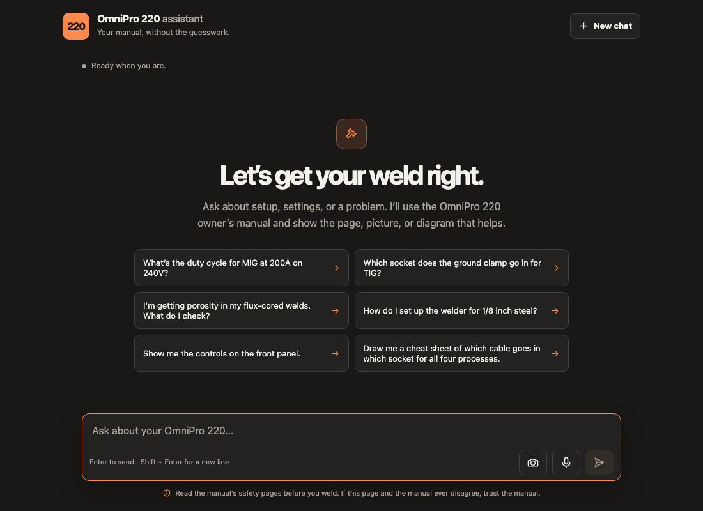
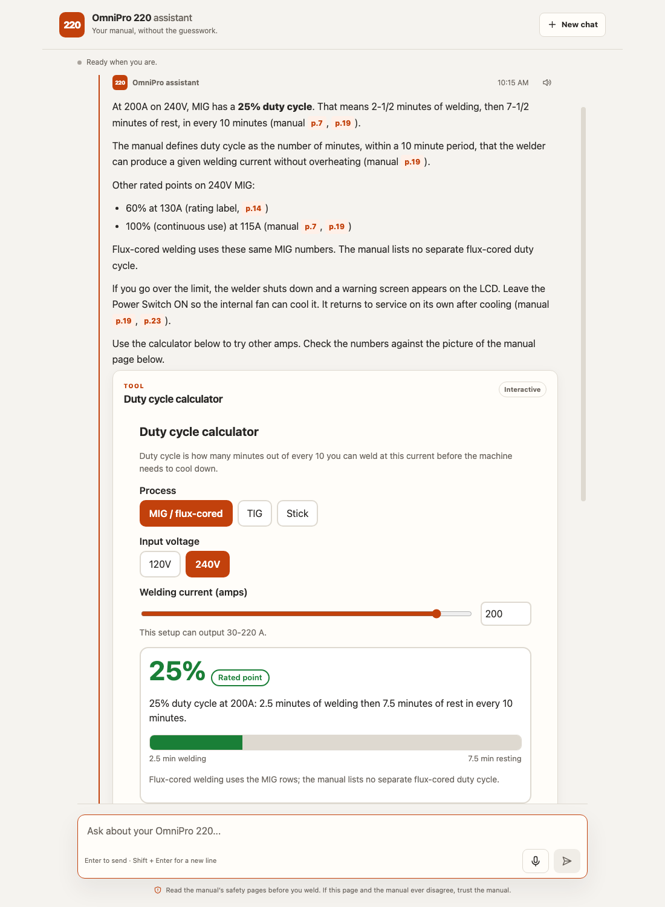
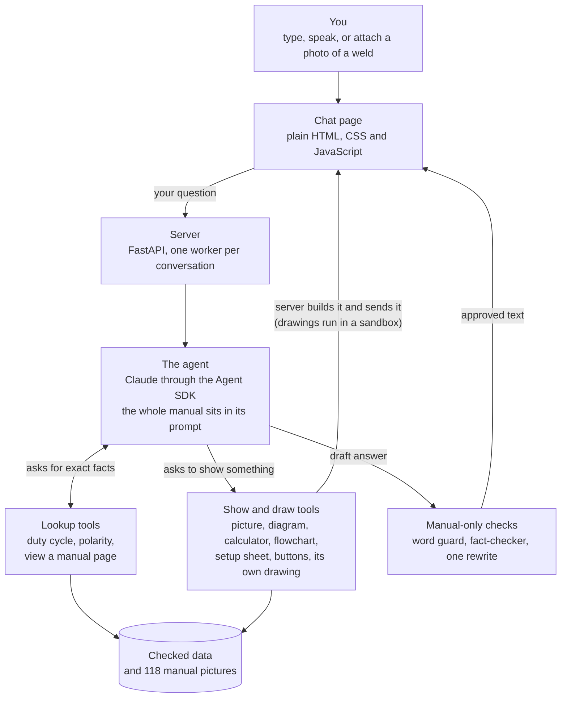
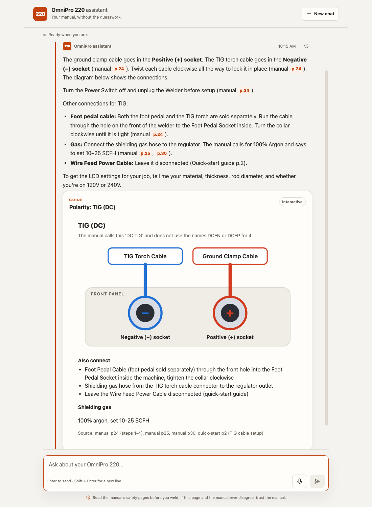
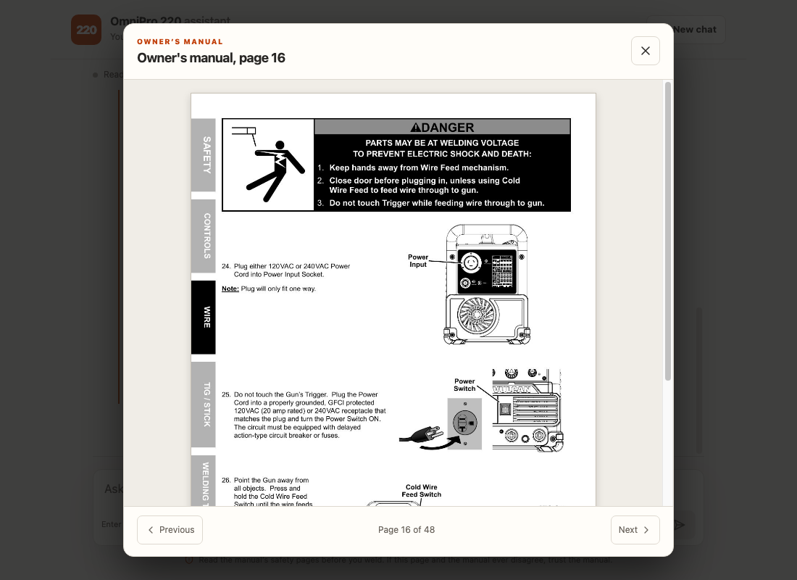
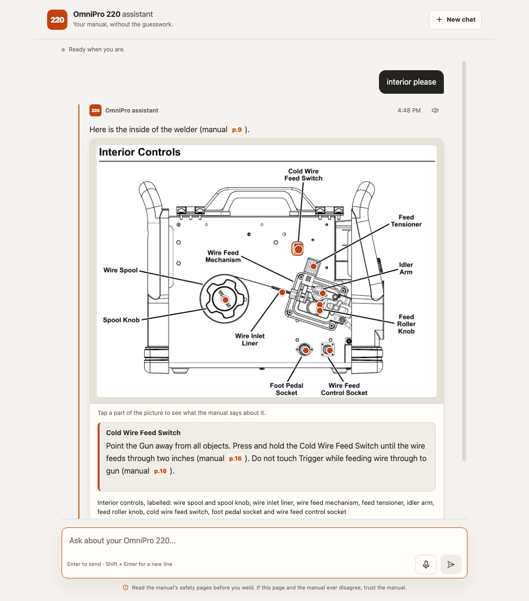
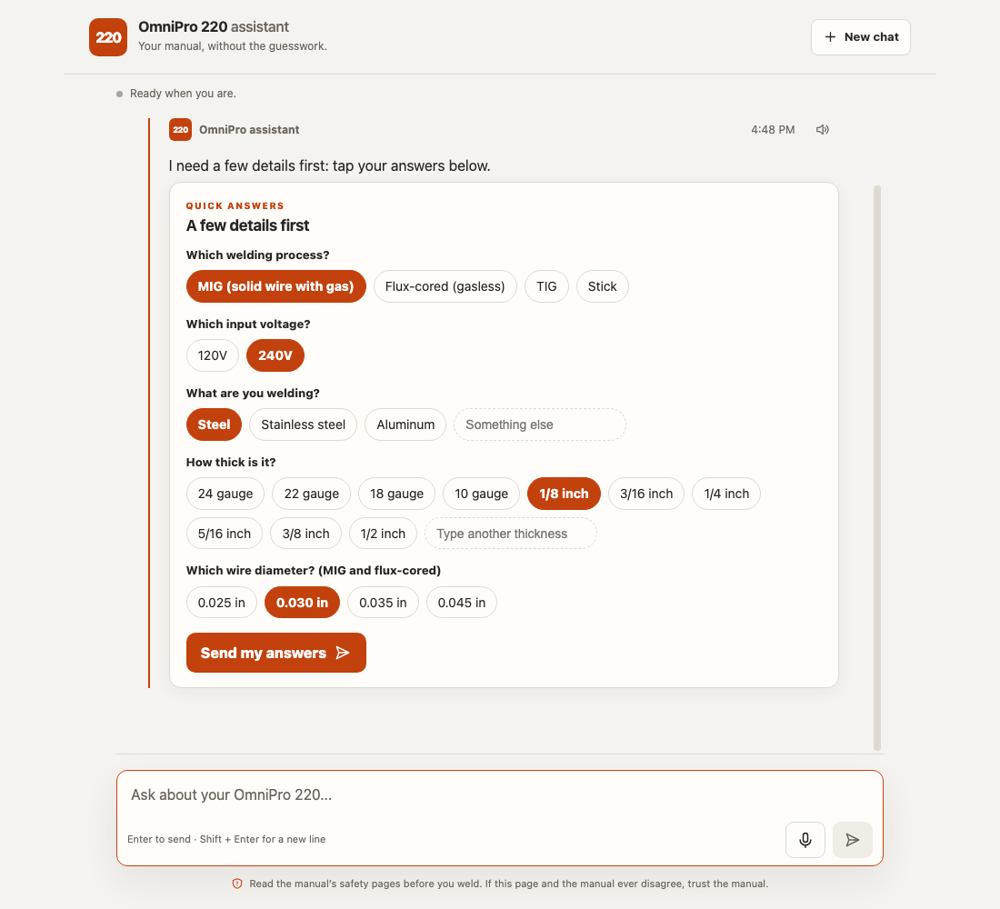
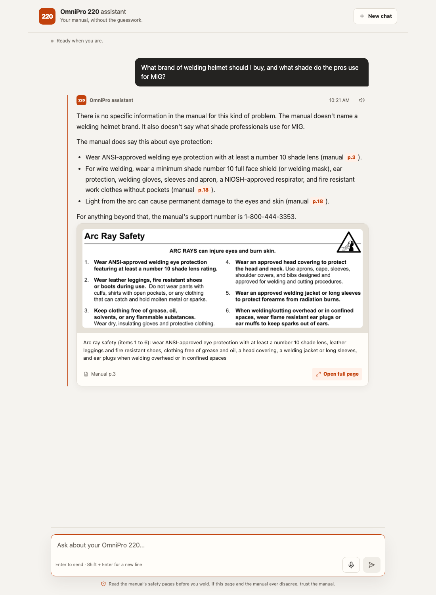

# OmniPro 220 assistant

This is a support assistant for the Vulcan OmniPro 220 multiprocess welder. You ask it a question the way you'd ask a friend who has read the whole owner's manual, and it answers from the manual. When a picture, a diagram or a small tool explains something better than words, it shows that instead of describing it.

**Video walkthrough:** <VIDEO_LINK>

<p align="center">
  
  
</p>

## Running it

```bash
git clone https://github.com/SomeshBhandarkar/prox-challenge
cd prox-challenge
cp .env.example .env      # open .env and paste your ANTHROPIC_API_KEY
python3 run.py
```

You need Python 3.10 or newer (`python run.py` on Windows). The first run creates a private `.venv` inside the project folder, installs the pinned requirements and opens http://localhost:8000. That's about 100 MB, mostly the Agent SDK, which carries its own engine, so on slow Wi-Fi give it a minute. After that it starts straight away. The key in `.env` is the only thing you have to supply. There's no npm step and nothing gets installed outside the folder.

I built this on my own API credits and they're nearly gone (about $<CREDITS_REMAINING> left as of <DATE>), so please run it with your own key.

| If you want to | Do this |
|---|---|
| Pick a model | The default is Sonnet 5.5. Use `python3 run.py --model haiku` or `--model opus`, or set `MODEL` in `.env`. |
| Skip opening a browser tab | `python3 run.py --no-open` |
| Use another port | `APP_PORT=8123` in `.env`. If 8000 is busy it takes the next free one by itself. |
| Switch off the second-model fact-check | `GROUNDING_JUDGE=off` in `.env` (the word-level checks stay on) |
| Look at the page without a key | `python3 run.py --setup-only`, then `.venv/bin/python -m scripts.dev_server` and open http://localhost:8100. It gives canned replies; type `figure`, `polarity`, `duty`, `flowchart`, `setup` or `details`. |
| Run the tests | `.venv/bin/pip install -r requirements-dev.txt`, then `.venv/bin/python -m pytest tests -q`. None of them call the API. |
| Chat in the terminal | `python3 run.py --terminal "How do I set up TIG?"` |

If the key, the port or the Python version is wrong, the app says what to fix in one line.

Some things worth asking first:

- *What's the duty cycle for MIG at 200A on 240V?*
- *Which socket does the ground clamp go in for TIG?*
- *I'm getting porosity in my flux-cored welds. What do I check?*
- *What settings should I use?* (it asks you with buttons)
- *Show me the controls on the front panel.* (tap the parts)
- Attach a photo of a weld and send *What's wrong with this weld?*
- *Draw me a cheat sheet of which cable goes in which socket for all four processes.*
- *What brand of welding helmet should I buy?* (not in the manual, so it says so)

## How the agent works

It's one agent with ten tools. I thought about splitting it into several agents, but one agent with good tools is simpler to follow and every tool can be tested on its own.



### What happens when you ask something

Say you ask *"What's the duty cycle for MIG at 200A on 240V?"*

1. The page sends the question to the server. Each conversation has its own background worker that owns the connection to the agent, and the status line under the header tells you what's going on ("Reading a page of the manual...").
2. The agent already has the whole manual in its prompt, plus the list of pictures and its rules. It doesn't answer the number from memory. It calls `duty_cycle(process="mig", voltage=240, amps=200)`.
3. The lookup answers from the specifications I checked by hand: 25%, which is 2.5 minutes of welding and 7.5 of rest in every 10, page 7. If you ask about 150A it says the manual gives no duty cycle at that current and shows the two nearest ratings, because the manual doesn't say.
4. The agent asks to show the calculator and the manual's own duty cycle page. The server sees those tool calls, builds the calculator itself and keeps it under a random token. The agent only gets back one short sentence saying it's on screen.
5. The agent writes its answer once, quoting the lookup and citing pages. The server holds the text back and checks it against the manual before you see it (more on that below).
6. The page puts the text first, then the calculator and the manual picture under it. `p.7` in the text is a button that opens that page of the manual.

### The tools

| Tool | What it does |
|---|---|
| `duty_cycle` | Looks up the duty cycle for a process, voltage and current. It also handles in-between currents, currents the machine can't reach, and 120V against 240V. |
| `polarity` | Which cable goes in which socket for each process. |
| `view_manual_page` | Lets the agent look at a whole manual page as an image, for a table or drawing it has no data for. |
| `show_figure` | Shows one of the 118 pictures I cut from the manual, chosen by id. |
| `show_polarity_diagram` | Draws the two sockets and which cable goes in each, from the polarity data. |
| `show_duty_cycle_calculator` | An interactive calculator. Its table is filled in from the same lookup as `duty_cycle`, so the two can't disagree. |
| `show_troubleshooting_flowchart` | The manual's troubleshooting steps as a flowchart you can click through. It also hands the exact steps to the agent. |
| `show_setup_guide` | A setup sheet for a job: whether the process fits, polarity, gas, feed roller and tension, the LCD steps with your entries filled in, and limits for 120V and 240V. |
| `ask_for_details` | Buttons for details it needs. The agent only names the topics (process, voltage, material, thickness, wire size, what the welder is doing). The options come from the checked data, so it can't invent one. Your taps go back as your next message. |
| `create_artifact` | The agent writes a small HTML or SVG drawing, which the page runs in a sandbox. |

### Why the whole manual is in the prompt

There's no vector database and no search step. The system prompt is about 45,000 tokens and the SDK caches it, so after the first question it's cheap to send. It's built by `app/prompt.py` from:

1. The role and tone: someone who just bought the welder and is standing in the garage, neither a beginner to talk down to nor an expert.
2. The accuracy rules: numbers only from a tool or the manual, always cite the page, and say "the manual doesn't say" instead of guessing.
3. The show rules: which picture or tool answers which kind of question.
4. A few fact blocks generated from the checked data, so they can't drift from it: the selection chart, the places where the manual contradicts itself, and a list of things the manual doesn't say.
5. The list of 118 pictures with their pages and captions, and the list of troubleshooting problems.
6. The manual itself, tagged page by page.

For a 48-page manual this works better than retrieval. Questions often need several pages at once (a duty cycle answer uses page 7, page 19 and the rating label on page 14), and with the whole manual in front of it the agent never misses a page because a search didn't find it.

### Showing things

The show tools are plain functions of their inputs. When the agent calls one, the server runs the same function with the same arguments and sends the result to the page (`app/show.py`). So the agent never writes the HTML for a calculator or a diagram, and what's on screen is exactly what the tool produced.

When no tool fits, the agent can draw its own picture with `create_artifact`. This follows the way Claude artifacts work: a typed block with an identifier, a type, a title and code; the page runs it in an iframe with `sandbox="allow-scripts"` and no same-origin access; the drawing reports errors and its height back with `postMessage`; drawing again with the same identifier replaces the old one; and if a drawing reports an error the agent gets one chance to fix it. The frame has no network, no cookies and no libraries, and the drawing can only use numbers and labels that are in the manual.

<p align="center">
  
  
</p>

### Pictures you can tap, and questions you can tap

The front panel (page 8) and the inside of the welder (page 9) come straight from the manual with a tappable spot on each of the 23 labelled parts. Tapping one shows what the manual says about it, in the manual's own words and with the page. When a question needs a detail from you, you get buttons instead of a list of questions to answer in text.

<p align="center">
  
  
</p>

### Photos and voice

You can attach a photo of a weld. The page shrinks it in your browser and the server checks that it really is a JPEG, PNG or WebP of a sensible size. The agent uses the photo for one thing: deciding whether it clearly matches one of the manual's weld pictures (pages 35 to 40). If it does, it shows that one picture and gives the manual's causes and corrections for it. If the photo isn't a weld, or doesn't clearly match any picture, it says so in a fixed sentence, shows no weld pictures, and points you to those pages to compare yourself. It doesn't describe your weld or guess a cause of its own.

For voice, there's a microphone next to Send that fills the question box as you speak, and you press Send yourself. A speaker button on each answer reads it aloud. Both use the browser's own speech features (Chrome and Edge), so there's no second API key.

### Staying inside the manual

The agent is only allowed to say what the manual says. If the manual doesn't cover a question, it answers with one fixed sentence, "There is no specific information in the manual for this kind of problem.", plus the support number printed in the manual. Early on the model kept adding helpful advice that wasn't in the manual, and a rule in the prompt wasn't enough to stop it, so the rule is enforced in code. The server holds each answer back and checks it in layers (`app/guard.py`, `app/judge.py`, `app/answering.py`):

1. A word-level guard rejects phrases like "typically", "most likely" or "my inference", any number with a unit that isn't in the manual, sentences about things the manual never mentions, and facts with no page cited. Direct quotes from the manual are fine.
2. A second, smaller model (Haiku) gets only the manual and the checked data, reads the answer a sentence at a time and marks anything the manual doesn't support.
3. If either check objects, the agent is asked once to rewrite using only the manual, and the first draft is thrown away unseen. Whatever is still unsupported is removed, and if nothing trustworthy is left you get the fixed sentence.

Pictures and drawings follow the same rule. `show_figure` only shows the 118 manual pictures, the widgets are built from the checked data, and a drawing is refused if it contains a number or label the manual doesn't have.

<p align="center">
  
</p>

## How the knowledge gets out of the manual

The manual has running text, tables, labelled diagrams, a wiring schematic and a selection chart that exists only as an image. Each needed its own treatment. I did the extraction once and committed the results, so nothing heavy runs when the app starts.

- **Text.** I pulled the text out of each page with poppler's `pdftotext` and saved it as `knowledge/manual.txt`, with a `=====PAGE n=====` marker before every page. The PDF's text layer scrambles the columns of some tables, so I never trust a number from it alone.
- **Tables become data.** The specifications, the extra 60% duty cycle points that only appear on the rating label, polarity for each process, the 13 troubleshooting problems with their 57 cause-and-fix steps, the LCD steps and the selection chart are all retyped as JSON in `knowledge/data/`, every entry carrying its page number. Tests then check every word of each entry against the text of the page it cites.
- **Pictures become crops.** Each figure is cut from the PDF with `pdftoppm`, using a box stored as fractions of the page. I found the crop edges by scanning the page for white gaps instead of eyeballing them, so a crop never slices through a drawing, and I looked at every one. Small details are cut at a higher resolution: the rating label at 1200 DPI, the schematic and parts diagram at 300.
- **The selection chart.** It's a single image with no text layer. I read it by eye, typed it into data, and wrote a check card (`knowledge/factcheck/SELECTION_CHART_CHECK.md`) so anyone can compare my version with the original.
- **The picture catalog.** Every crop has an id, a page, its box, a caption, and a list of the questions it helps answer. Text that only exists inside a picture, like the numbers on an LCD screen, is recorded separately so the tests can still check captions against it. The quick-start guide and the selection chart are separate PDFs and are cropped the same way, with their own source labels.

| In the manual | How it's stored | How I check it |
|---|---|---|
| Running text | `knowledge/manual.txt`, page-tagged | Every answer cites its pages. |
| Tables | JSON in `knowledge/data/` | Tests check every word against the cited page, and that no wire speed or voltage number sneaks in. |
| Pictures and diagrams | 118 exact crops in `knowledge/figures/` with the catalog | Tests check each crop matches its box, isn't a whole page or a sliver, and that every number in a caption is on the cited page. |
| Front panel and inside pictures | The same crops, plus a tappable spot for each part in `knowledge/data/hotspots.json` | Every word of each explanation has to be on the pages it cites, and socket texts must agree with the polarity data. |
| Image-only chart | Transcribed to data, and the original image is shown too | A check card to compare against the original. |
| Wiring schematic, parts diagram | 300 DPI crops. The agent can open the page image with `view_manual_page`, and a few facts I checked by eye are in the prompt. | In one early run the model misread a tiny connector label (it said CN8; the LCD plugs into CN5). Now the prompt states the facts I checked and tells the agent not to guess other labels. |

A page-coverage test requires every manual page to have a figure or a written reason it doesn't (only the warranty page is text-only). A drift test fails if the prompt, the tools and the picture catalog stop agreeing with each other.

The manual also contradicts itself in a few places. The safety page says not to use the welder outdoors, while the chart calls flux-cored "ideal for outdoor or windy conditions". The Settings Chart is "inside the door" on one page and "on top of the welder" on another. I wrote these into `caveats.json` and into the prompt, and the agent brings one up only when the question is about that topic, saying which one to trust.

## Design decisions

- **One agent, not several.** The task asks for a reasoning agent, and one agent with good tools is easier to follow, test and debug.
- **The whole manual in a cached prompt, not retrieval.** Forty-eight pages fit comfortably, and answers that need several pages can't fail on a search miss. The cost is that every request carries the manual, which the cache makes cheap. A manual ten times bigger would need retrieval.
- **Numbers come from tested lookups over checked data.** The PDF text scrambles some tables, and a wrong number on a welder is a safety problem. A lookup can be tested; the model's memory can't.
- **Exact crops of the manual's own pictures.** If someone wants to see the wire feed mechanism, they should see the manual's figure, not a description of it.
- **The server builds the visuals.** The agent only chooses what to show. That way a widget can never contain a number the agent made up, and the HTML never costs tokens.
- **Drawings run in a sandbox with no network and no libraries.** If the agent writes something odd there's nothing for it to reach. The price is plain HTML, SVG and JavaScript only.
- **Manual-only is enforced in code.** For the reason above: a prompt rule alone wasn't enough.
- **No invented wire speed or voltage.** You might expect a settings configurator that prints those two numbers, but this machine is synergic: you enter the wire diameter and material thickness on the LCD and it sets them itself, and the manual contains no table for them. The setup sheet gives everything the manual does say and tells you the LCD sets the two numbers.
- **A plain HTML, CSS and JavaScript page.** A reviewer only needs Python, and the page can run under a strict Content-Security-Policy with no inline scripts and nothing loaded from outside. I drafted the look in v0 and rebuilt it by hand without a framework.
- **Text first, pictures after.** Pictures that arrive before the text pushed the answer off screen, so each answer shows its text first and the pictures under it.
- **Voice from the browser, not a paid service.** The reviewer should only need one key. The speech fills the question box instead of sending, so a misheard "TIG" can be fixed first.
- **Sonnet 5.5 as the default model.** It's the one I ran most through the real page. Haiku and Opus are a flag away.
- **How I checked it.** I wrote an 85-question exam, including trick questions, multi-turn conversations and questions the manual can't answer, plus 36 more aimed at making the agent say something outside the manual. I ran them through the agent and read every answer against the manual. More than a thousand offline tests cover the data, the pictures, the widgets, the server and the page. `scripts/run_exam.py` and `scripts/conditions.py` run the questions and score the rules.
